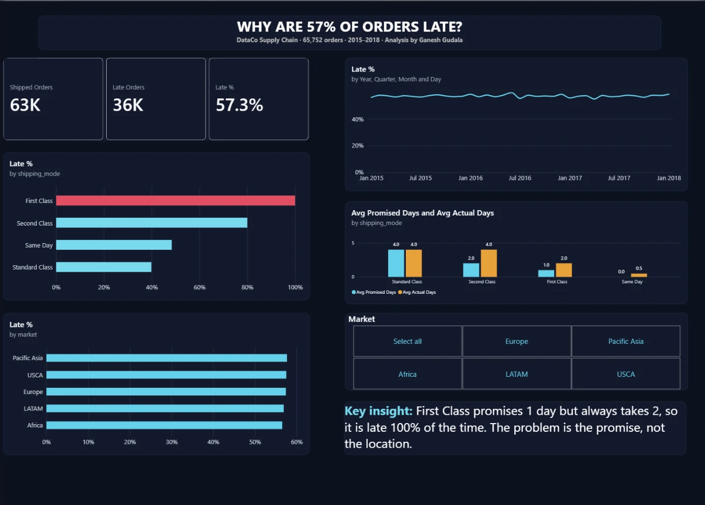
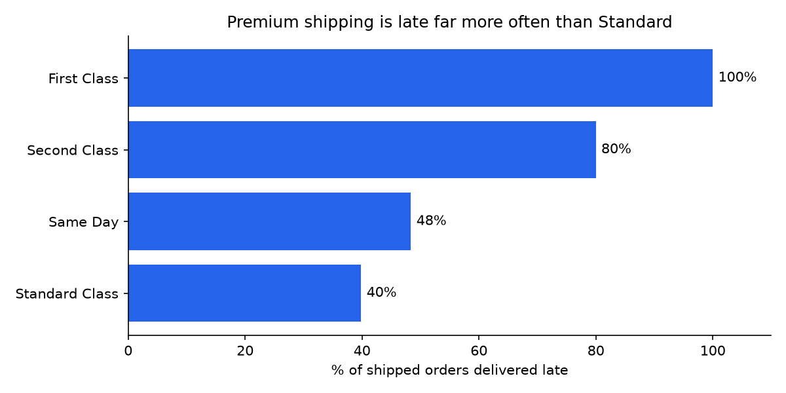
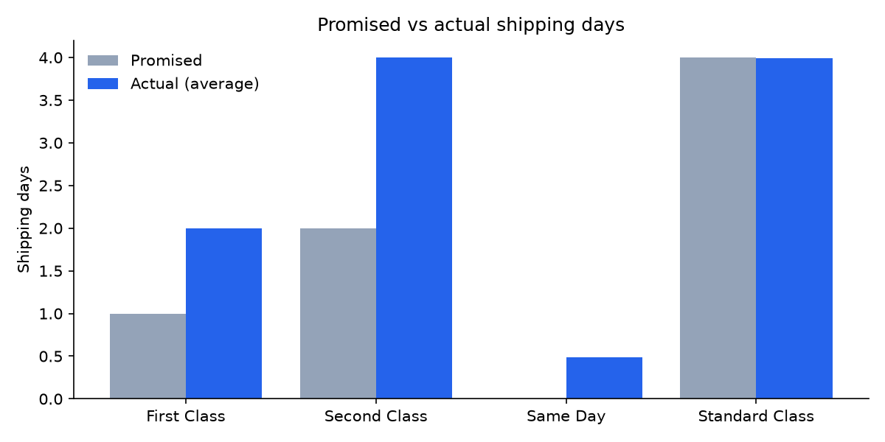

# Why Are Deliveries Late? — Supply Chain Delivery Performance Analysis

**Tools:** Python (pandas, matplotlib) · SQL (SQLite) · Power BI (DAX)
**Data:** [DataCo Smart Supply Chain dataset](https://www.kaggle.com/datasets/shashwatwork/dataco-smart-supply-chain-for-big-data-analysis) — 180,519 order items, 65,752 orders, Jan 2015 – Jan 2018

## Business question
DataCo, a global retailer, delivers a majority of its orders late. **Where are the delays, what is driving them, and what should the business change?**

## Key findings

**1. 57.3% of shipped orders arrived late** — 36,048 of 62,897 orders, representing **$18.1M of $31.6M** in revenue.

**2. The cause is the shipping promise, not geography or customer type.**

| Shipping mode | Promised days | Actual days (avg) | Late rate |
|---|---|---|---|
| First Class | 1 | 2.0 | **100%** |
| Second Class | 2 | 4.0 | **80%** |
| Same Day | 0 | 0.5 | 48% |
| Standard Class | 4 | 4.0 | 40% |

First Class promises 1 day but **always** takes 2. Second Class promises 2 days but takes about 4. The premium services customers pay more for are the ones that break their promise most.

**3. Location is not the cause.** Every market sits at 56.5%–57.7%, every customer segment at ~57%, and even the worst country (Nicaragua, 59.6%) is only ~2 points above average.

**4. The problem is structural, not seasonal.** The monthly late rate stayed between 55% and 60% for three years with no improvement.

**5. Volume vs severity.** Standard Class has the most late revenue ($7.5M) simply because it carries the most orders — but **100% of First Class revenue ($4.9M) arrived late**.

## Recommendations
1. **Reset delivery promises to match reality** — First Class to 2 days, Second Class to 4 days. This alone would turn most "late" premium orders into on-time ones.
2. **Or invest to meet the current promise** — if 1-day First Class is a competitive must-have, fund faster carriers or regional stock for premium orders.
3. **Prioritise premium customers** — they pay more and currently get the worst experience; they are the highest churn risk.
4. **Track on-time rate by shipping mode as a KPI**, not just overall — the overall figure hides where the failure is.

## Approach

| Step | What | File |
|---|---|---|
| 1 | Data quality check, cleaning and feature engineering in Python | [`01_data_cleaning.ipynb`](01_data_cleaning.ipynb) |
| 2 | Eight business questions answered in SQL | [`02_sql_analysis.ipynb`](02_sql_analysis.ipynb) |
| 3 | Interactive Power BI dashboard (KPI cards, market filter, trend and promise-vs-actual views) | [`delivery_dashboard.pbix`](delivery_dashboard.pbix) |

**Data cleaning highlights**
- Identified that one row = one order **item**, not one order, and aggregated to order level before calculating late rates (the naive item-level figure, 54.8%, understated the problem).
- Excluded 2,855 cancelled orders from on-time metrics — the source data had silently counted them as "not late".
- Dropped 16 columns: empty (`Product Description` 100%, `Order Zipcode` 86%), masked, personal, constant, and six exact duplicate columns.
- Converted text dates, renamed columns to `snake_case`, translated 164 Spanish country names to English.
- Flagged that data volume drops by more than half from Oct 2017 (likely incomplete).

**SQL techniques used:** `COUNT(DISTINCT)`, conditional aggregation with `CASE WHEN`, `GROUP BY` / `HAVING`, `ROUND`, `ORDER BY` / `LIMIT`.

**Power BI:** built on an order-level table (`powerbi_orders.csv`, exported by notebook 1) with DAX measures — `Shipped Orders`, `Late Orders`, `Late %` (`DIVIDE`), `Avg Promised Days`, `Avg Actual Days` (`CALCULATE` with filters to exclude cancelled orders). The late-rate trend uses a zero-based axis so small month-to-month noise isn't exaggerated. Custom dark theme in [`reference/powerbi_theme.json`](reference/powerbi_theme.json).

## How to run
1. Download the dataset from Kaggle and put `DataCoSupplyChainDataset.csv` in a `data/` folder.
2. `pip install pandas matplotlib jupyter jupysql`
3. Run `01_data_cleaning.ipynb` (creates `data/supply_chain.db` and `data/powerbi_orders.csv`), then `02_sql_analysis.ipynb`.
4. Open `delivery_dashboard.pbix` in Power BI Desktop (if prompted, point the data source to `data/powerbi_orders.csv`).

## Note on tools
The Python cleaning notebook and the Power BI theme were built with AI assistance (Claude). The business questions, SQL analysis, dashboard and findings are my own work.

---
**Ganesh Gudala** · MSc Supply Chain & Logistics, University of Roehampton · [LinkedIn](https://www.linkedin.com/in/ganesh-gudala-39817a244)
